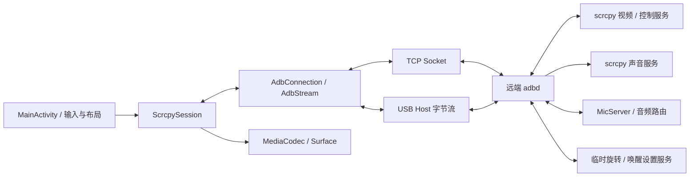

# 架构与约束

[文档索引](README.md) · [配置与数据](configuration.md) · [验证指南](testing.md)

## 数据路径

应用使用原生 Java / Android View，不依赖宿主机 adb 可执行文件。传统 / TLS TCP Socket 与 Android USB Host 提供字节流，再交给同一套 vendored adblib 完成 RSA 授权和 ADB 逻辑通道。视频、控制、声音和 shell 服务共用这一条 ADB 连接。

图中 ADB 通道双向复用；声音最终由本机 `AudioPlayback` 播放，本机麦克风由 `MicForwarder` 发送至远端 `MicServer`。远端服务通过 `app_process` 临时启动，不安装常驻应用，不额外开放网络端口。

## 代码地图

以下类均在 [应用源码目录](../app/src/main/java/cn/ohmyterm/scrcpy/) 下；ADB 库单独列出。

| 文件 / 模块 | 职责 |
| --- | --- |
| `MainActivity.java` | 配置、保存 / 切换弹窗、USB 权限、设置、会话状态、Surface 生命周期、横竖屏布局 |
| `PairingDialog.java`、`AdbIdentity.java` | 无线配对界面、本机名称、各传输共用的持久化 RSA 身份 |
| `adb/`、`src/main/cpp/` | mDNS 发现、配对包、STLS / TLS 传输、BoringSSL JNI 包装 |
| `Profile.java`、`UiText.java` | 配置 JSON 与缺省兼容；应用级语言选择 |
| `ScrcpySession.java` | 建连、RSA 身份、服务上传、视频头与帧解析、控制队列、运行时服务开关、关闭协调 |
| `Protocol.java` | scrcpy 按键 / 组合键、触控、剪贴板控制消息编码 |
| `UsbAdb.java`、`UsbAdbStreams.java` | ADB 接口与 Bulk 端点识别、USB 请求、ADB 包边界、取消和资源释放 |
| `RemoteInputView.java`、`EdgeGesture.java` | 多指事件、画面坐标映射、边缘动作和触点释放 |
| `RemoteKeyboard.java`、`KeyboardState.java` | 六行键盘、滑动字符、修饰键锁定、连续按键 |
| `SafeRail.java`、`ScrollHintView.java` | 横屏圆角 / 摄像头避让；配置页剩余内容提示 |
| `AudioForwarder.java`、`AudioPlayback.java` | 独立远端声音服务、AAC 解码、本机播放 |
| `MicForwarder.java`、`MicServer.java` | 本机录音与发送；远端音频路由与 PCM 注入 |
| `RemoteDeviceSettings.java` | 保持远端原设置，执行旋转 / 保持唤醒并在退出时恢复 |
| `RemoteServerProcess.java` | 把子进程生命周期绑定到其 ADB shell，只结束自身子进程 |
| [com/tananaev/adblib/](../app/src/main/java/com/tananaev/adblib/) | ADB 包、授权、逻辑通道、流控与关闭通知；本地修改见第三方说明 |
| [validation/probe/](../validation/probe/) | 一次性验证应用，接收真实触控、按键、文字并提供声音探针 |

## 连接与关闭

1. UI 读取并校验配置。USB 路径先获得本机 USB 权限，结果必须匹配当前请求，且回到前台后才能继续。
2. `ScrcpySession` 复制配置，创建 TCP 或 USB 传输，加载 / 生成本机 ADB RSA 密钥并完成远端授权。
3. 生成本会话的随机标识，启动远端设置服务，上传固定版本 server 到会话专属临时路径。
4. 启动官方 scrcpy 视频服务，通过 ADB `localabstract:` 通道读取视频和写控制。视频服务关闭音频，声音使用独立服务。
5. 解析设备信息、编码信息、画面尺寸和帧数据，由 `MediaCodec` 解码到 Surface。首帧真正渲染后才报告就绪。
6. 开启所需声音 / 麦克风服务；后续运行时开关通过串行任务调整服务，不重建视频通道。
7. 正常断开先取消输入、停止声音和运行时工作，通知设置服务恢复原值，再排空必要控制消息并关闭传输；超时会强制收尾。异常关闭也要解除阻塞的读写。

解码器仅在能力查询确认支持时开启低延迟模式，避免 Android 11 等不支持该选项的解码器在配置阶段失败。

远端设置 shell 保存初始旋转和保持唤醒值，并用退出处理恢复设置、删除会话临时文件。连接丢失后依靠 shell EOF 收尾；这不等于保证设备掉电或远端系统异常时仍可执行恢复。视频 / 声音子进程同样由所属 shell 管理，不能用 `pkill scrcpy` 等广泛匹配代替。

具体实现：[ScrcpySession](../app/src/main/java/cn/ohmyterm/scrcpy/ScrcpySession.java)、[远端设置](../app/src/main/java/cn/ohmyterm/scrcpy/RemoteDeviceSettings.java)、[进程归属](../app/src/main/java/cn/ohmyterm/scrcpy/RemoteServerProcess.java)。

## 修改时要保留的约束

### 传输与控制

- ADB 逻辑通道提供字节流，单次 `read()` 不保证对应完整视频帧或控制消息。分包、最后一包、流关闭和 ACK 必须分别处理。
- 控制队列有界，组合键的按下与释放作为一个队列项发送；不能只丢弃某段释放事件。队列拥塞时结束会话并提示。
- USB 写入分开处理 24 字节 ADB 包头与 payload，以最多 16 KiB 的 Bulk 分块发送；payload 恰为端点包长倍数时发送零长度结束包。
- USB 读取按包头 / 剩余 payload 的准确长度请求；零长度 USB 包不代表 EOF，不能要求远端额外发结束包。取消后由读线程完成原生资源释放。
- USB 设备移除结束对应会话，不自动连接另一种传输。权限事件不能复用旧请求或跨会话启动连接。

### 输入、布局与语言

- 边缘动作作用于远控画面及周边可用黑边，保留本机强制系统区域。判定为导航手势时取消原触控，不能留下远端按住状态。
- 控件导航 Home 与键盘编辑 Home 不同；Win 是 Meta。收起键盘、旋转或断开要清理修饰键和触点。
- 布局跟随本机方向；远端方向由同步开关或手动旋转决定，两者不能混为一件事。仅观看不发送控制、麦克风或方向变更。
- 语言切换保留未保存表单值、USB 选择和视频连接。使用 `UiText` 与两套资源，新增弹窗沿用已有样式、固定底部操作区和安全区处理。

### 声音与生命周期

- 播放和麦克风各自启动 / 关闭，不因切换一个开关重建视频。旧异步任务失败不能关闭新服务，UI 回调也必须匹配当前会话。
- 麦克风按需申请权限，默认关闭；能力不可用时反馈到对应开关和提示，保留视频。
- 本机麦克风服务使用 APK 自身作为远端 `CLASSPATH`，只复制临时文件，不安装；关闭后撤销音频策略。
- `MediaCodec` 的释放由视频工作线程协调，先结束输出线程，避免与解码或重复释放竞争。

## 上游与兼容

server 固定为官方 scrcpy 5.0.1。下载、握手版本、参数、视频头和控制消息必须一起核对，不能只换下载链接。上游与许可见 [第三方说明](../third_party/README.md)，升级流程见 [发布指南](release.md)。

## 无线配对与 TLS

配对按 AOSP v1 协议执行：TLS 1.3 导出密钥与配对秘密组合后交给 SPAKE2，再以 HKDF 派生 AES-128-GCM 密钥，交换固定大小的 PeerInfo。二维码使用 Android Studio 的 `WIFI:T:ADB` 格式，由主控展示、被控端扫描；服务名与秘密每次刷新重新随机生成。

配对与后续 ADB 连接加载同一个 `AdbIdentity`。传统授权公钥备注和配对公钥备注均使用本机名称。TCP 收到 STLS 后回复并在原 Socket 上升级；USB 沿用原始字节流。TLS 使用 ADB 自签名证书规则，不使用网页证书校验；配对秘密通过 TLS exporter 绑定当前连接，后续由远端验证已配对的 RSA 身份。

BoringSSL 的所有内存 BIO 操作与输出记录在同一锁内，阻塞 Socket 读取在锁外，避免视频读取卡住控制写入。关闭时先关 Socket 解除等待，再在锁内释放 SSL。JNI 指针只由传输拥有。配对有 45 秒总超时，取消 / 模式切换 / Activity 销毁关闭连接，过期结果不能更新新页面。mDNS 解析串行处理，服务消失 / 页面关闭停止使用其结果。
